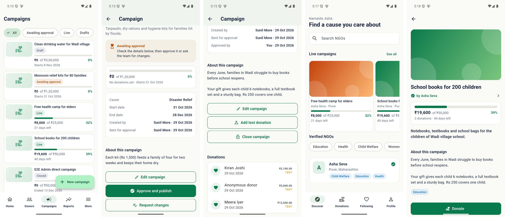

# ngo-platform

India NGO Management & Donation SaaS platform (monorepo).

- `apps/mobile` — Flutter app (Android + iOS)
- `services/*` — Spring Boot microservices
- `infrastructure/` — Podman, Kubernetes, OpenShift
- `docs/` — architecture, API, testing, release docs
- `scripts/` — Windows developer-machine setup

Toolchain lives in `D:\tools`. Run `scripts\setup.cmd` to install / verify it.

Current state and next steps: [IMPLEMENTATION_STATUS.md](IMPLEMENTATION_STATUS.md).
Screenshots of the app: [docs/screenshots](docs/screenshots/README.md).

All accounts, phone numbers and passwords in this repository are fictional development/test values.
